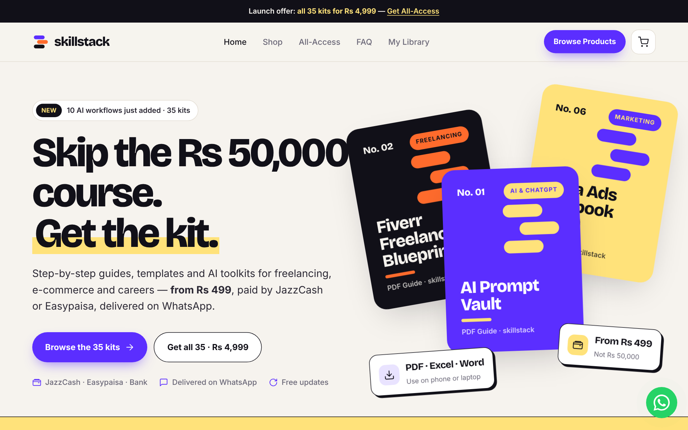
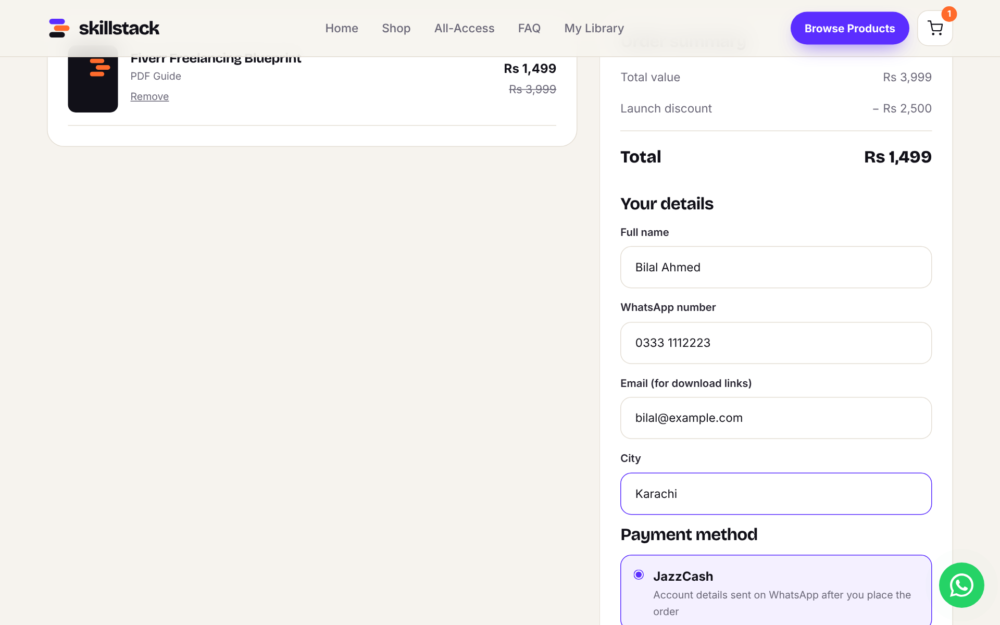
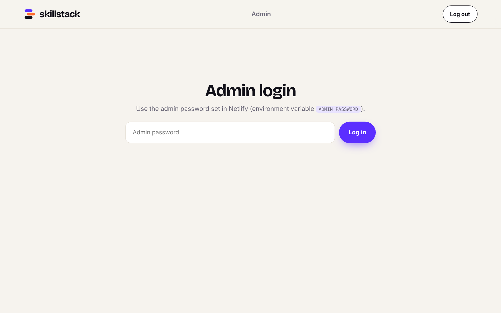
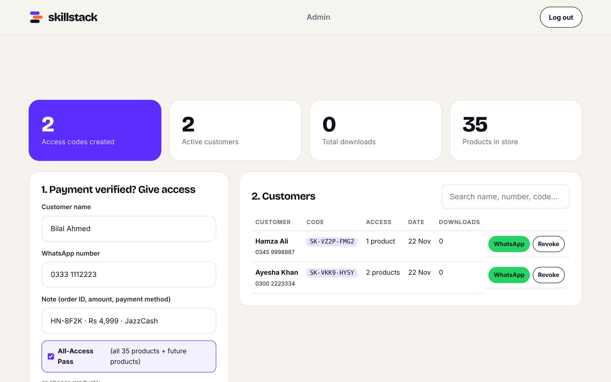
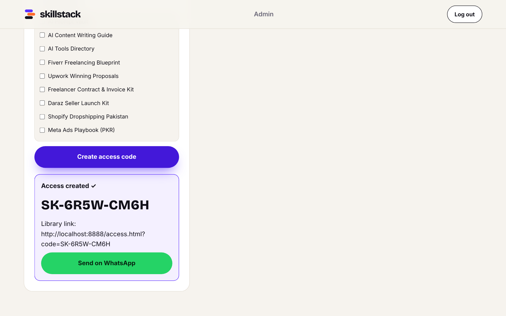
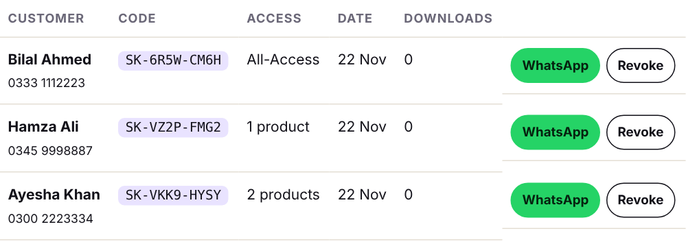
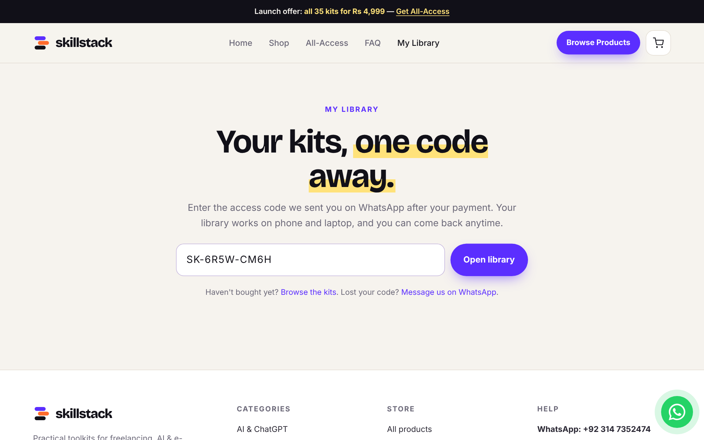
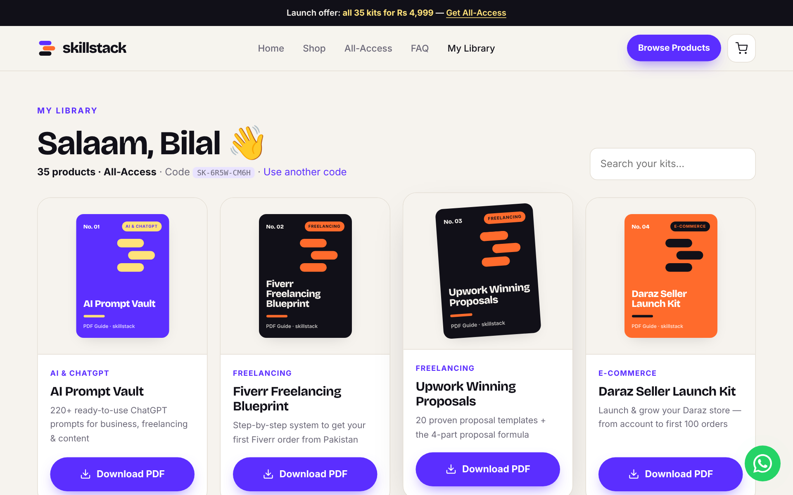
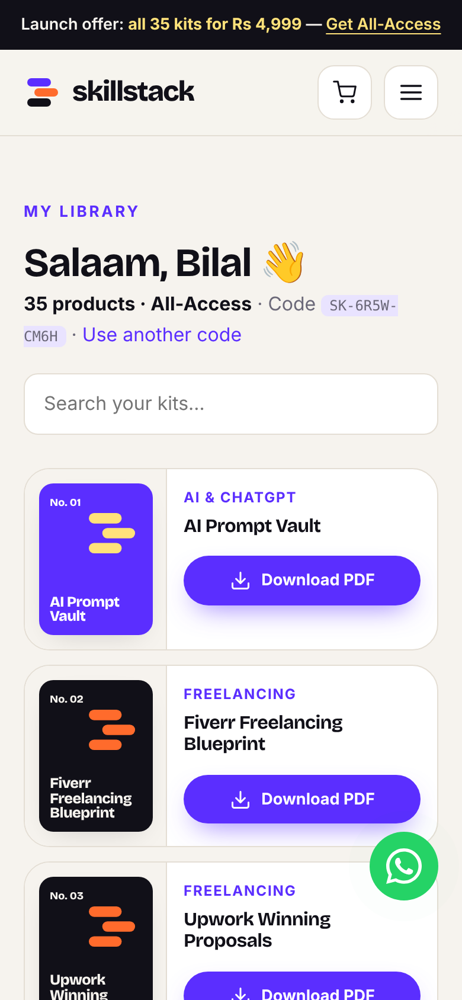

# Skillstack — Complete Setup & Owner's Guide

> **Yeh guide kis liye hai:** Is mein shuru se aakhir tak sab kuch likha hai: package mein kya hai, website live kaise karni hai, har order ka product customer tak kaise pohanchana hai, social media aur ads kaise shuru karne hain, aur masla aaye to kya karna hai. Steps order mein follow karein. Koi technical tajurba zaroori nahi.

## Contents
1. Package mein kya hai
2. Business kaise chalta hai (poora flow)
3. Step 1 — Zaroori details jama karein
4. Step 2 — Website live karein (Netlify)
5. Step 3 — Pehla test order
6. Step 4 — Rozana orders deliver karna (Admin panel)
7. Step 5 — Customer ka experience (My Library)
8. Step 6 — Social media launch
9. Step 7 — Meta ads
10. Prices, payment details ya products badalna
11. Masle aur unka hal (Troubleshooting)
12. Security tips
13. Launch-day checklist

---

## 1. Package mein kya hai

| Folder | Kya hai | Kab use hoga |
|---|---|---|
| `00-START-HERE.pdf` | Yeh guide | Sab se pehle |
| `01-Website-Store` | Poora online store: website, **My Library** (customer area), **Admin panel**, secure downloads aur 35 product files. Bilkul ready to deploy | Step 2 |
| `02-Products` | Wohi 35 products alag files mein (28 PDF guides including 10 AI workflows, 4 Excel tools, 3 Word template packs) | Backup, ya kabhi manually bhejna ho |
| `03-Branding` | Logo (SVG + PNG), profile picture, Facebook cover, YouTube banner, WhatsApp status, website link-preview image | Step 6 |
| `04-Social-Posts` | 9 launch posts (1080×1350) | Step 6 |
| `05-Ad-Creatives` | 9 ad designs (1080×1350) | Step 7 |
| `06-Strategy-Docs` | 7 PDFs: niche research, brand guidelines, AI workflows, 90-day Meta ads plan, content calendar & captions, launch guide | Business chalane ke liye |
| `07-Videos` | Website preview videos + access system demo | Dikhane / promo ke liye |
| `08-Source-Files` | Editable poora project (prices, text, designs yahan se dobara banti hain) | Section 10 |

**Products ki list:** 35 products, 7 categories (AI & ChatGPT, Freelancing, E-commerce, Marketing, Career & Jobs, Business Tools, AI Workflows). Single products **Rs 499 – Rs 1,999** ke hain, aur **All-Access Pass (saare 35 + aane wale products) Rs 4,999** ka hai.

---

## 2. Business kaise chalta hai (poora flow)

1. Customer ads, Instagram ya Google se website par aata hai aur product choose karta hai.
2. Cart → apni details → **Place order on WhatsApp**. WhatsApp khulta hai aur order ka message (order ID, products, total) **+92 314 7352474** par aata hai.
3. Aap customer ko payment details bhejte hain (JazzCash / Easypaisa / bank). Customer payment karke screenshot bhejta hai.
4. Aap apne JazzCash / Easypaisa / bank app mein payment check karte hain.
5. Aap **Admin panel** (`aapkiwebsite.com/admin`) mein customer ka **access code** banate hain aur **Send on WhatsApp** dabate hain.
6. Customer link kholta hai → **My Library** → apne products download karta hai, phone ya laptop par, jab chahe.





> Har order mein aap ka kaam sirf ~20 second ka hai: payment check karein → admin mein code banayein → WhatsApp bhejein.

---

## 3. Step 1 — Zaroori details jama karein

Yeh details sirf aap (client) de sakte hain. Inhein developer ko bhejein, ya khud Section 10 ke tareeqe se lagayein:

- [ ] JazzCash account title + number
- [ ] Easypaisa account title + number
- [ ] Bank ka naam, account title + IBAN
- [ ] Support email (misal: support@skillstack.pk)
- [ ] Instagram, Facebook aur TikTok ke final links
- [ ] Admin password socha hua (kam se kam 8 characters, letters + numbers; kisi se share na karein)

> Jab tak asli accounts nahi lagte, checkout par likha aata hai *"Account details sent on WhatsApp after you place the order"*. Is tarah kisi customer ko koi ghalat number nazar nahi aata, aur aap WhatsApp par khud details bhej dete hain.

WhatsApp number **+92 314 7352474** website ke har button par pehle se laga hai.

---

## 4. Step 2 — Website live karein (Netlify, free)

Website **Netlify** par host hogi (free plan shuru ke liye kaafi hai). Access system chhote server functions use karta hai, is liye website **Netlify CLI** se upload hoti hai.

> ⚠️ Netlify ka "drag and drop" deploy **use na karein**. Woh sirf pages upload karta hai, access system (admin, library, downloads) nahi chalega.

### 4.1 Node.js install karein (sirf ek dafa)
1. **nodejs.org** par jayein → **LTS** version download karein → install (Next, Next, Finish).
2. Computer restart kar dein (Windows par behtar hai).

### 4.2 Folder mein terminal kholein
- **Windows:** `01-Website-Store` folder kholein → upar address bar par click karein → `cmd` likhein → **Enter**. Kala window (Command Prompt) usi folder mein khul jayega.
- **Mac:** Terminal app kholein → `cd ` likhein (cd ke baad space) → `01-Website-Store` folder ko Terminal window par drag karein → **Enter**.

### 4.3 Yeh 4 commands ek ek karke chalayein
Har command type/paste karein aur **Enter** dabayein. Agli command tab chalayein jab pichli khatam ho jaye.

```
npm install
npm install -g netlify-cli
netlify login
netlify deploy --prod
```

- `npm install` — zaroori package download karta hai (1–2 minute).
- `npm install -g netlify-cli` — Netlify ka tool install karta hai. Mac par error aaye to `sudo npm install -g netlify-cli` likhein aur apna Mac password daalein.
- `netlify login` — browser khulega → Netlify par free account banayein (Google/GitHub/email) → **Authorize** dabayein.
- `netlify deploy --prod` — pehli dafa poochega *"What would you like to do?"* → **Create & configure a new project** chunein → team chunein → project ka naam (misal `skillstack`). Aakhir mein **Production URL** dikhega (jaise `https://skillstack.netlify.app`). Yahi aap ki website hai.

### 4.4 Admin password set karein
1. **app.netlify.com** → apna project kholein.
2. **Project configuration** (ya *Site configuration*) → **Environment variables** → **Add a variable** → *Add a single variable*.
3. **Key:** `ADMIN_PASSWORD` · **Value:** aap ka strong password → **Create variable**.
4. Terminal mein dobara chalayein: `netlify deploy --prod` (password ab lag jayega).

> Password ke baghair ya 8 characters se chhote password ke sath admin panel khulega hi nahi. Yeh jaan boojh kar rakha gaya hai, taake koi aur andar na aa sake.

### 4.5 Apna domain lagayein
1. Domain khareedein: `skillstack.pk` (kisi PKNIC-accredited registrar se) ya `skillstack.com.pk` / `.com`. Pehle IPO-Pakistan ki website par trademark search kar lein.
2. Netlify → project → **Domain management** → **Add a domain** → apna domain likhein → Netlify jo DNS records batata hai, woh apne domain registrar ke panel mein daal dein.
3. 1–24 ghante mein domain chal jayega. HTTPS (taala) Netlify khud laga deta hai.

---

## 5. Step 3 — Pehla test order (zaroor karein)

Live hone ke baad yeh test apne phone par karein:

- [ ] Website kholein → koi product → **Buy Now** → details bharein → **Place order on WhatsApp**. WhatsApp order message ke sath **+92 314 7352474** par khulna chahiye.
- [ ] `aapkiwebsite.com/admin` → password se login → apne naam se code banayein (1 PDF, 1 Excel, 1 Word product tick karein).
- [ ] **Send on WhatsApp** → link kholein → library mein teeno products nazar aayein.
- [ ] Teeno download karein aur kholein: PDF, Excel (Google Sheets ya Excel app mein) aur Word (Google Docs ya Word app mein).
- [ ] Admin mein us code ko **Revoke** karein → library dobara kholein: "no longer active" aana chahiye. Phir **Restore** kar dein.

Sab sahi hai to store ready hai. ✅

---

## 6. Step 4 — Rozana orders deliver karna (Admin panel)

**Admin panel:** `aapkiwebsite.com/admin`. Isay apne phone par **bookmark** ya **Add to Home Screen** kar lein.

### 6.1 Login


Woh password daalein jo Netlify mein `ADMIN_PASSWORD` ke taur par set kiya tha. Browser tab band hone tak aap logged in rahenge. Kaam khatam ho to **Log out** dabayein.

### 6.2 Payment verify hone ke baad access dena


1. **Customer name** — customer ka naam.
2. **WhatsApp number** — `03XX XXXXXXX` format theek hai. System khud `92` laga deta hai.
3. **Note** — order ID, raqam aur payment method (misal: `HN-8F2K · Rs 4,999 · JazzCash`). Yeh aap ka sales record ban jata hai.
4. Products chunein:
   - **All-Access Pass** tick karein agar bundle khareeda hai (saare 35 + future products), **ya**
   - neeche list se sirf woh products tick karein jo customer ne khareede.
5. **Create access code** dabayein.



6. Code nazar aayega (misal `SK-6R5W-CM6H`). **Send on WhatsApp** dabayein → WhatsApp mein message pehle se likha hota hai (library link + code) → **Send**.

### 6.3 Customers ki list


- **Search** box mein naam, number ya code likh kar dhoondein.
- **WhatsApp** button — customer ka code kho gaya ho to dobara bhejein.
- **Revoke** — access band (refund hua ho ya code internet par share ho gaya ho).
- **Restore** — band kiya hua access wapas chalu.
- **Downloads** — customer ne kitni dafa download kiya. Agar ek code ke downloads bohat zyada hon (misal 50+), to ho sakta hai code share ho gaya ho. Us code ko revoke karein aur customer ko naya code bana kar dein.

### 6.4 Aam situations
| Situation | Kya karein |
|---|---|
| Customer ne aur products khareede | Naya code bana dein (sirf naye products ke sath), ya purana revoke karke sab ke sath naya bana dein |
| Single product wala customer bundle par upgrade kare | Naya code **All-Access** ke sath bana dein, purana revoke kar dein |
| Customer ka phone badal gaya / code bhool gaya | List mein naam search karein → **WhatsApp** dabayein |
| Refund diya | Us ka code **Revoke** karein |

---

## 7. Step 5 — Customer ka experience (My Library)

Customer ko link milta hai: `aapkiwebsite.com/access.html?code=SK-XXXX-XXXX`. Link kholte hi library khul jati hai. Website ke menu mein **My Library** se bhi code daal kar khol sakte hain.







- Customer ko sirf apne khareede hue products nazar aate hain, aur har product ke sath **Download** button hota hai.
- Code browser mein yaad rehta hai, is liye agli dafa seedha library khulti hai.
- **Excel** files phone par **Google Sheets** ya **Microsoft Excel** app mein khulti hain, aur **Word** files **Google Docs** ya **Word** app mein.
- Product files website par kahin public nahi hain. Sirf active code se download hoti hain.

**Customer ke liye ready reply (agar poochein "kaise download karun?"):**
> Assalam o Alaikum! Jo link humne bheja hai us par click karein → aap ki library khul jayegi → jis product ka "Download" button dabayenge woh aap ke phone/laptop mein save ho jayega. Excel files ke liye Google Sheets app aur Word files ke liye Google Docs app behtar hai. Koi masla ho to yahin message karein 😊

---

## 8. Step 6 — Social media launch

1. **Profile picture** har jagah: `03-Branding/logo/profile-picture.png`.
2. **Facebook cover:** `03-Branding/banners/facebook-cover-1640x624.png` · **YouTube:** `youtube-banner-2560x1440.png`.
3. **Instagram bio:** `Practical skill kits for 🇵🇰 freelancers & sellers | Fiverr · AI · Daraz · CVs | From Rs 499 · JazzCash/Easypaisa | 👇 35 kits` + website link.
4. **WhatsApp Business:** logo, business description, greeting message, away message, aur labels (New lead, Waiting payment, Access sent).
5. **9 launch posts** (`04-Social-Posts`) **ulte order** mein post karein: pehle Post 9, aakhir mein Post 1, taake grid sahi dikhe. Har post ki caption aur hashtags `06-Strategy-Docs/05-Content-Calendar-and-Captions.pdf` mein hain.
6. Launch ke baad 30 din ka content plan bhi usi PDF mein hai.

---

## 9. Step 7 — Meta ads

`06-Strategy-Docs/04-Meta-Ads-90-Day-Plan.pdf` follow karein:
- **Week 0:** Business Manager, ad account (PKR), Pixel (Section 10.4) aur WhatsApp connection set karein.
- **Day 1–30 (Test):** 9 ad designs (`05-Ad-Creatives`) ke sath shuru karein, Rs 1,500–2,000/day. Har ad ki copy usi PDF mein hai.
- **Day 31–60 (Optimise):** jo ads achhe chalein unhi jaise naye ads banayein.
- **Day 61–90 (Scale):** jo ads profit de rahe hon unka budget aahista aahista barhayein (har 2–3 din mein 20–30%).
- Ads mein kabhi "guaranteed income" jaisi baat na likhein. Meta aise ads reject karta hai.

---

## 10. Prices, payment details ya products badalna

Har product ka naam, price, description aur payment accounts **ek hi file** mein hain: `08-Source-Files/tools/catalog.py`. Is file ko badal kar website aur saari PDFs dobara ban jati hain. Agar aap technical nahi hain to yeh kaam developer se karwa lein (10–15 minute ka kaam hai).

### 10.1 Ek dafa ka setup (developer / aap)
1. **python.org** se Python 3 install karein (Windows par install ke waqt **"Add Python to PATH"** tick karein).
2. `08-Source-Files` folder mein terminal kholein (Section 4.2) aur chalayein:

```
pip install reportlab openpyxl python-docx
npm install
```

### 10.2 Badlaav karna
1. `tools/catalog.py` ko Notepad (ya VS Code) mein kholein.
2. **Payment details:** `"payments"` wale hisse mein `Account Title Here` aur numbers ki jagah asli details likhein.
3. **Price:** product ki line mein `price=999` jaisa number badlein (`mrp` = kati hui "value" price).
4. Save karein, phir terminal mein chalayein:

```
python tools/build_all.py
```

### 10.3 Website update karna
Isi `08-Source-Files` folder se:

```
netlify deploy --prod
```

Pehli dafa poochega to **Link this directory to an existing project** chunein aur apna `skillstack` project select karein. Is se pehle bane saare access codes mehfooz rehte hain.

### 10.4 Meta Pixel lagana
Pixel ka code `08-Source-Files/tools/build_site.py` mein `<!-- Meta Pixel: paste your pixel code here -->` wali line ki jagah paste karein, phir 10.2 aur 10.3 chalayein. Website add-to-cart aur checkout ke events khud Pixel ko bhejti hai.

### 10.5 Asli customer reviews lagana
Customer ki ijazat se `tools/build_site.py` mein `TESTIMONIALS = []` ke andar reviews daalein (naam, shehar, text). Homepage par reviews ka section khud nazar aane lagega. Sirf asli reviews daalein.

### 10.6 Naya product add karna
`tools/catalog.py` mein `PRODUCTS` list mein nayi entry daalein. PDF products ka content `tools/content/` mein jata hai (jaise baqi products ka hai). Phir 10.2 aur 10.3 chalayein. All-Access customers ko naya product khud mil jata hai.

---

## 11. Masle aur unka hal (Troubleshooting)

| Masla | Hal |
|---|---|
| Windows par `python` ya `pip` "is not recognized" | `py tools/build_all.py` aur `py -m pip install ...` likhein, ya Python dobara install karein "Add Python to PATH" tick karke |
| `npm` ya `node` "is not recognized" | Node.js install nahi hua ya terminal purana hai. Node.js install karein, terminal band karke dobara kholein |
| `netlify` "is not recognized" | `npm install -g netlify-cli` dobara chalayein, terminal band karke dobara kholein |
| Admin: "Wrong admin password" | Password check karein. Netlify mein `ADMIN_PASSWORD` set kiya hai? Set karne ke baad `netlify deploy --prod` dobara chalaya? Password 8+ characters ka hai? |
| Library / admin "Page not found" ya kaam nahi karta | Website drag-and-drop se upload hui thi. `01-Website-Store` folder se `netlify deploy --prod` chalayein |
| Customer: "access code was not found" | Code spelling check karein (code mein 0, O, 1, I istemal nahi hote). Admin list mein search karein, zaroorat ho to WhatsApp se dobara bhejein |
| Customer: "no longer active" | Code revoke hua hai. Agar ghalti se hua to **Restore** dabayein |
| Download: "File temporarily unavailable" | Deploy adhoora hua. `01-Website-Store` (ya `08-Source-Files`) se `netlify deploy --prod` dobara chalayein |
| Phone par Excel/Word file nahi khulti | Google Sheets / Google Docs ya Microsoft Excel / Word app install karein |
| WhatsApp ghalat number par khulta hai | `tools/catalog.py` mein `whatsapp` number check karein → Section 10 |
| Ek code ke downloads bohat zyada | Code share ho gaya hoga. Revoke karein aur customer ko naya code dein |

---

## 12. Security tips

- Admin password kisi se share na karein, aur shak ho to Netlify mein badal kar `netlify deploy --prod` chalayein.
- Netlify account par 2-factor authentication on karein.
- Har order ka note (order ID, raqam, method) zaroor likhein. Yeh aap ka record hai.
- Har product file mein buyer licence likha hai (sirf khareedne wale ke liye, aage share ya resell karna mana hai).
- `02-Products` ki copy Google Drive ya kisi USB mein bhi rakhein (backup).

---

## 13. Launch-day checklist

- [ ] Asli payment accounts lag gaye aur website rebuild ho gayi (Section 10)
- [ ] Website apne domain par HTTPS ke sath live hai
- [ ] `ADMIN_PASSWORD` set hai, admin login chal raha hai
- [ ] Test order → admin code → library download (PDF, Excel, Word) phone par mukammal
- [ ] Revoke / Restore test ho gaya
- [ ] Profiles (DP, cover, bio) set, 9 posts live
- [ ] WhatsApp Business: greeting, away message, labels
- [ ] Meta Pixel laga hua, Phase 1 ads launch

**Mubarak ho, aap ka Skillstack store ready hai! 🚀**
